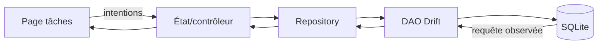

**Navigation :** [← Sommaire](./README.md) · [Corrigés (à consulter après)](./corriges.md)

# PARTIE III — EXERCICES FINAUX ET MINI-PROJET

> **À faire avant les corrigés.** Les exercices ci-dessous combinent plusieurs modules. Pour les diagnostics, dites d’abord quelle couche est en cause, puis proposez une correction minimale et expliquez pourquoi elle fonctionnerait.

## A. Questionnaire de révision — gestion d’état Flutter

Répondez sans réciter une définition : expliquez les conséquences.

1. Une fonction de bouton incrémente une variable Dart ordinaire. Quelle partie du programme change, et qu’est-ce qui manque pour actualiser la vue?
2. Pourquoi Flutter peut-il créer un nouvel objet `Widget` tout en conservant son objet `State`?
3. Quand choisir `initState`, `didUpdateWidget` et `dispose` pour un abonnement à un objet reçu du parent?
4. Pourquoi le nombre de tâches ouvertes est-il souvent un état dérivé plutôt qu’un deuxième champ mutable?
5. Dans la remontée d’état, que transmet-on vers le bas et que renvoie-t-on vers le parent?
6. Quelle différence fonctionnelle existe entre `ChangeNotifier` et Provider?
7. Une opération ponctuelle de chargement et une observation continue demandent-elles le même contrat (`Future` ou `Stream`)? Justifiez.
8. Où placeriez-vous le filtre courant d’une page, la validation du titre et la liste persistante? Pourquoi?

## B. Questionnaire de révision — Drift et SQLite

1. Quel est le rôle de SQLite, et quel est celui de Drift?
2. Quelles différences séparent une colonne Drift, son type Dart et sa représentation SQL?
3. Pourquoi utiliser un companion plutôt qu’une ligne complète pour une mise à jour partielle?
4. Pourquoi un `DELETE` ou un `UPDATE` sans `where` mérite-t-il une revue particulière?
5. Distinguez insertion, `update(...).replace(row)` et upsert.
6. Pourquoi une clé étrangère déclarée doit-elle aussi être activée/testée sur SQLite?
7. Quel compromis apporte un index composé `(projectId, status)`?
8. Pourquoi une migration n’est-elle pas équivalente à l’édition de la classe `Table`?
9. Que peut détecter `SchemaVerifier` qu’un test de base neuve ne détecte pas?
10. Quelle est la différence entre `get()` et `watch()`?

## C. Exercices de diagnostic — pourquoi le code ou le résultat ne fonctionne-t-il pas?

### D1 — Le texte reste figé

```dart
onPressed: () {
  count++;
}
```
Le compteur mémoire augmente au débogueur mais le texte visible reste identique. Identifiez le mécanisme manquant.

### D2 — Le générateur ne démarre pas

Le projet a `drift` sous `dependencies`, mais pas `drift_dev` ni `build_runner` sous `dev_dependencies`. `database.g.dart` manque. Pourquoi `dart run build_runner build` ne peut-il pas produire la classe attendue?

### D3 — Ça marche sur mon installation neuve

Une colonne `priority` a été ajoutée à la déclaration Drift et le code a été généré. L’application fonctionne après réinstallation, mais plante sur un téléphone mis à jour. Quel changement manque?

### D4 — Toutes les tâches ont changé

```dart
await (database.update(database.tasks)).write(
  const TasksCompanion(done: Value(true)),
);
```
L’utilisateur voulait cocher une seule tâche. Pourquoi le résultat est-il incorrect?

### D5 — Le Stream ne voit pas l’édition externe

`watchTasks()` ne réémet pas après qu’un outil externe a modifié le fichier SQLite. Est-ce nécessairement un bug du Stream Drift? Quelle précaution faut-il prendre?

### D6 — Le flux redémarre souvent

Un widget appelle `database.watchTasks()` directement dans `build`. Après des changements sans rapport, les abonnements semblent se recréer. Quel est le problème de durée de vie?

## D. Exercices de conception — choisir et justifier

### C1 — État local

Un seul widget ouvre/ferme un panneau « détails ». Choisissez une approche et dites pourquoi un provider global peut être disproportionné.

### C2 — Préférence globale

Le thème courant est consulté sur plusieurs écrans et doit être modifiable depuis une page de réglages. Choisissez une portée et un mécanisme de partage plausibles.

### C3 — Opération métier traçable

Un paiement suit validation, autorisation, succès/échec, et l’équipe veut observer explicitement chaque événement. Comparez Cubit et BLoC, puis justifiez un choix.

### C4 — Source durable de tâches

Les tâches doivent être disponibles hors ligne et survivre au redémarrage. Choisissez où les stocker et indiquez ce que cette solution ne fournit pas.

### C5 — Chargement unique

Un écran ouvre une fiche une fois et ne s’attend pas à une mise à jour pendant qu’il reste ouvert. Quel contrat asynchrone convient? Que changeriez-vous si un autre écran pouvait modifier cette fiche en direct?

## E. Exercices — relations, contraintes et index

### R1 — Direction de la relation

Un projet contient plusieurs tâches; une tâche appartient à un seul projet obligatoire. Dans quelle table placer la FK? Quelle contrainte empêche un `projectId` inexistant?

### R2 — Plusieurs-à-plusieurs

Un projet peut porter plusieurs étiquettes et chaque étiquette peut appartenir à plusieurs projets. Dessinez la table de liaison et choisissez une clé qui empêche d’attacher deux fois la même étiquette au même projet.

### R3 — Suppression métier

Comparez `CASCADE`, `RESTRICT` et `SET NULL` pour la suppression d’un projet. Donnez un cas raisonnable pour chacun et les préconditions de `SET NULL`.

### R4 — Recherche fréquemment utilisée

Une page filtre les tâches par `projectId`, `status`, puis les trie par `createdAt`. Proposez un index candidat, puis donnez une limite qui empêche de le déclarer universellement parfait.

### R5 — Unicité

Les noms de projets peuvent se répéter entre utilisateurs, mais pas pour un même utilisateur. Quelle unicité faut-il exprimer : sur `name` seul ou sur `(userId, name)`? Pourquoi un index ordinaire ne suffit-il pas?

## F. Exercices — migrations de schéma

### MIG1 — Ajouter une valeur optionnelle

La v1 a `tasks(id, title)`. La v2 ajoute une échéance facultative. Décrivez la nouvelle version, la modification et ce que deviennent les lignes historiques.

### MIG2 — Ajouter une colonne obligatoire

La v1 a des milliers de tâches. La v2 ajoute `priority NOT NULL`. Pourquoi l’ajout naïf peut-il échouer ou perdre l’information? Proposez une valeur historique et un test.

### MIG3 — Modifier une représentation

La v1 stocke le statut en texte (`'open'`, `'done'`); la v2 souhaite un autre type. Quelles transformations de données, contraintes et tests sont nécessaires avant de livrer?

### MIG4 — Vérifier les versions anciennes

La version actuellement publiée est v3. Quelle base créer dans un test pour prouver que le chemin v1→v2→v3 préserve titre, statut et identifiant?

## G. Exercices — flux réactifs et UI

### FL1 — Choisir `get` ou `watch`

Un écran affiche une liste susceptible de changer après chaque commande. Quel appel convient? Un export ponctuel qui génère un fichier doit-il s’abonner à un Stream?

### FL2 — Ordonner le flux

Ordonnez : nouvel instantané, insertion Drift, reconstruction du `StreamBuilder`, notification de table observée, action utilisateur.

### FL3 — Écriture hors Drift

Une requête `watch` suit une table, mais un outil SQLite écrit hors de Drift. Pourquoi l’observateur peut-il ne rien voir? Citez un contournement possible et sa précaution.

### FL4 — État séparé

Une liste de tâches se met à jour par `watch`; un filtre « ouvertes/terminées » ne doit pas survivre à la fermeture. Où stocker chaque chose? Pourquoi `setState` ne remplace-t-il pas la base?

## H. Mini-projet final — Gestionnaire de tâches Flutter + Drift

**But :** créer, lire, modifier, chercher, filtrer par statut et supprimer des tâches; les retrouver après redémarrage; faire évoluer la base avec une migration testée. Ne cherchez pas à écrire tout le code d’un coup. Chaque étape est indépendante et réutilise les modules précédents.

### Architecture de départ

```text
lib/
  data/app_database.dart       # tables Drift, connexion, schemaVersion
  data/tasks_dao.dart          # requêtes SQL/Drift ciblées
  data/task_repository.dart    # contrat et adaptation métier
  feature/tasks/task_state.dart# filtre/chargement/erreurs/actions
  feature/tasks/task_page.dart # widgets et callbacks
```

Le diagramme de responsabilité :



L’architecture peut commencer plus simple et être séparée au besoin. La liste persistée reste dans SQLite; le filtre courant et le texte du formulaire sont temporaires. Un statut peut être enregistré comme code texte stable (`open`, `inProgress`, `done`) plutôt que dépendre de l’ordre d’une enum.

### Étape 1 — Définir le comportement et le modèle

- **Objectif :** décider des données et scénarios avant de déclarer les tables.
- **À construire :** modèle de tâche avec identifiant, titre, statut, dates; un statut initial et les règles d’un titre valide.
- **Critères de réussite :** l’équipe peut expliquer ce qui persiste, ce qui est dérivé et les transitions valides (ex. ouverte → terminée).
- **Notions à mobiliser :** modules 4, 8, 12, 13, 17.

### Étape 2 — Installer Drift et créer la première base

- **Objectif :** ouvrir une base locale et générer l’API de Drift.
- **À construire :** dépendances d’exécution/développement, `AppDatabase`, `@DriftDatabase`, `part`, connexion `driftDatabase(name: ...)`, `schemaVersion = 1`.
- **Critères de réussite :** build_runner produit le `.g.dart`; ouvrir/fermer la base ne dépend pas de `build`.
- **Notions à mobiliser :** modules 10 et 11.

### Étape 3 — Déclarer le schéma v1 et faire le CRUD

- **Objectif :** créer et relire une tâche en base.
- **À construire :** table `Tasks` avec `id`, `title`, `status` et `createdAt`, valeurs requises/défauts cohérents; fonctions `addTask`, `getTasks`, `updateStatus`, `deleteTask`.
- **Critères de réussite :** les écritures s’achèvent avec un résultat; UPDATE/DELETE ciblent l’identifiant; les contraintes refusent un titre invalide.
- **Notions à mobiliser :** modules 12 à 15.

### Étape 4 — Isoler requêtes et règles métier

- **Objectif :** empêcher l’UI d’accéder directement au SQL.
- **À construire :** DAO pour les requêtes, repository pour le contrat métier, règle de titre non vide et gestion des erreurs.
- **Critères de réussite :** on peut tester la règle sans widget et remplacer le consommateur de données sans modifier la table.
- **Notions à mobiliser :** modules 8, 15 et 23.

### Étape 5 — Chercher, filtrer, trier et paginer

- **Objectif :** réaliser les besoins de lecture sans charger inutilement toute la base.
- **À construire :** recherche par texte, filtre de statut, tri par date et une limite/page; compter les résultats sans lire toutes les lignes si nécessaire.
- **Critères de réussite :** testez recherche exacte vs partielle, AND/OR, null et limite; l’ordre de page est stable.
- **Notions à mobiliser :** modules 16 et 19.

### Étape 6 — Afficher les tâches en mode réactif

- **Objectif :** actualiser la liste à la suite d’une écriture Drift.
- **À construire :** `watchTasks(status)` dans le repository/DAO et un `StreamBuilder` ou provider équivalent; une commande ajoute ou change le statut.
- **Critères de réussite :** l’écran reçoit la nouvelle liste sans `setState` manuel de rafraîchissement; chargement et erreurs ont un affichage; le Stream n’est pas recréé à chaque build.
- **Notions à mobiliser :** modules 7, 21 et 22.

### Étape 7 — Relier les tâches à un projet

- **Objectif :** ajouter une relation relationnelle avec intégrité référentielle.
- **À construire :** table `Projects`, FK nullable/obligatoire selon la règle, politique de suppression choisie; requête pour lister les tâches d’un projet.
- **Critères de réussite :** un projet inexistant est rejeté quand les FK sont activées; le comportement de suppression est couvert par un test.
- **Notions à mobiliser :** modules 13, 14 et 19.

### Étape 8 — Faire évoluer le schéma en v2

- **Objectif :** ajouter une priorité aux tâches sans effacer les données existantes.
- **À construire :** nouvelle version, snapshots Drift, étape v1→v2 et valeur initiale cohérente (par exemple zéro); ne pas remplacer cette migration par une réinitialisation destructive.
- **Critères de réussite :** une tâche v1 garde son identifiant, titre, statut et date; priorité vaut la valeur convenue après migration.
- **Notions à mobiliser :** module 20.

### Étape 9 — Tests de fiabilité et redémarrage

- **Objectif :** vérifier la persistance et les chemins importants.
- **À construire :** tests CRUD/contrainte/relation/filtre/transaction/flux/migration; un test fichier temporaire qui ferme et rouvre la base.
- **Critères de réussite :** migration depuis v1 testée avec données, pas uniquement `onCreate`; ressources fermées dans les tests; aucune tâche ne disparaît après réouverture.
- **Notions à mobiliser :** modules 18, 20, 24 et 25.

### Revue finale du mini-projet

Avant de considérer le projet fiable, répondez à ces questions : quelle est la source de vérité des tâches? Que se passe-t-il si l’écriture échoue? Quel utilisateur historique reçoit quel défaut de v2? Que voit l’UI pendant le chargement? Quelle opération est transactionnelle? Quelles requêtes sont réellement indexées? Quelles données sont sauvegardées ou synchronisées hors appareil?
