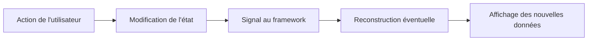

**Navigation :** [Sommaire](../README.md) · [Module 2 →](./02-stateless-stateful.md)

# Module 1 — Comprendre la notion d’état

## 1. Objectif pédagogique

À la fin du module, vous distinguerez la donnée, la variable, l’état et l’interface. Vous saurez pourquoi une modification Dart n’actualise pas forcément l’écran, et pourrez décrire le trajet d’une action jusqu’au nouvel affichage.

## 2. Le problème à résoudre

Un compteur affiche `0`. L’utilisateur appuie sur « + » : la valeur doit devenir `1`. Le programme peut bien modifier un entier en mémoire; si Flutter n’est pas averti qu’il doit recalculer l’interface, l’écran peut continuer d’afficher `0`.

## 3. Explication du fonctionnement

Une **donnée** est une information, par exemple le nombre `0`. Une **variable** est un emplacement nommé où le programme peut lire ou remplacer une valeur. L’**état** est l’ensemble des informations actuelles qui peuvent influencer le résultat futur du programme — ici, la valeur du compteur ou le fait qu’un bouton soit activé. L’**interface utilisateur** (UI) est la représentation visuelle de ces informations.

Flutter ne dessine pas l’écran en surveillant toutes les variables Dart. Les widgets décrivent une interface; le framework reconstruit les parties concernées lorsqu’un mécanisme connu lui signale un changement. Modifier `count++` change bien la mémoire Dart, mais pas automatiquement l’arbre de widgets. Dans un `State` local, `setState` est l’un des mécanismes qui avertissent Flutter.

Le **state d’un widget** est l’information nécessaire à ce composant. Les **données de l’application** peuvent être partagées entre plusieurs écrans ou venir d’un dépôt/base. Un champ saisi mais pas encore enregistré, une case cochée momentanément ou l’onglet affiché sont souvent temporaires. Une tâche que l’utilisateur veut retrouver après fermeture doit être persistée ailleurs (module 9).

Une mise à jour peut entraîner une reconstruction, de nouveaux calculs de layout/rendu et un nouvel affichage. Une reconstruction n’est pas forcément une recréation de chaque objet d’état ni un redessin coûteux de tout l’écran : Flutter réconcilie les descriptions avec son arbre interne.

## 4. Petit extrait de code

```dart
int count = 0;
void increment() {
  count++; // mémoire modifiée, mais Flutter n'est pas averti
}
```

## 5. Explication ligne par ligne

- `int count = 0` crée une variable Dart contenant la valeur initiale. À elle seule, elle n’est pas une « variable observée » par Flutter.
- `increment` est une fonction appelée en réponse à une action.
- `count++` remplace la valeur en mémoire par sa valeur précédente plus un. Cette instruction n’envoie aucun signal au framework : un widget qui a déjà été construit ne se met donc pas à jour par magie.

## 6. Déroulement interne

Dans une interface réactive, le cycle conceptuel est :



Pour un bouton activé/désactivé, l’état est un booléen; pour un champ texte, le contenu courant est un état de formulaire. Ces états peuvent être visibles immédiatement sans être enregistrés durablement.

## 7. Pourquoi cette approche ?

Séparer l’état de sa représentation permet de décrire l’UI comme une fonction de données : mêmes données, même interface attendue. Le framework sait alors décider quoi recalculer. La limite est qu’il faut choisir un mécanisme de notification adapté et éviter de déclencher inutilement de grands sous-arbres.

## 8. Erreur classique

**Erreur :** « La variable a changé, donc l’écran va suivre. » Une variable ordinaire ne connaît pas Flutter. **À éviter :** demander qui détient la donnée, qui observe sa modification et quel signal provoque une nouvelle construction.

## 9. Questions de compréhension

1. Si `count++` est exécuté dans une variable locale à une fonction appelée par un bouton, qu’est-ce qui a changé en mémoire? Qu’est-ce qui n’a pas encore été demandé à Flutter?
2. Un champ de recherche est modifié puis l’application est fermée avant validation : cet état devait-il nécessairement être persistant? Pourquoi?
3. Dans un bouton désactivé, quelle donnée peut servir d’état, et quelle partie de l’interface en dépend?

## 10. Petit exercice pratique

- **Objectif :** séparer donnée, état et affichage dans un exemple.
- **Situation de départ :** une ligne de tâche montre une case à cocher et un titre.
- **Résultat attendu :** identifier l’information qui change lorsqu’on coche la tâche et l’information visuelle qui doit suivre.
- **Consignes :** écrivez en une phrase l’action, l’état avant/après et l’élément d’UI recalculé. Indiquez si cette information doit survivre au redémarrage.
- **Critères de réussite :** vous ne confondez pas la case dessinée avec la donnée `terminée`, et vous justifiez la persistance.
- **Indice facultatif :** distinguez le changement instantané de l’écran de l’enregistrement durable.

## 11. Résumé essentiel

- Une variable Dart est une valeur en mémoire; elle n’est pas automatiquement observée par Flutter.
- L’état décrit une situation courante dont dépend le comportement ou l’UI.
- L’interface est reconstruite à partir d’une description; reconstruire n’équivaut pas à recréer tout l’état.
- Une donnée temporaire et une donnée à conserver n’ont pas le même lieu de stockage.

## 12. Lien avec le module suivant

Nous allons voir comment Flutter fournit un mécanisme local — `StatefulWidget` et `setState` — pour conserver cet état et demander une reconstruction.
