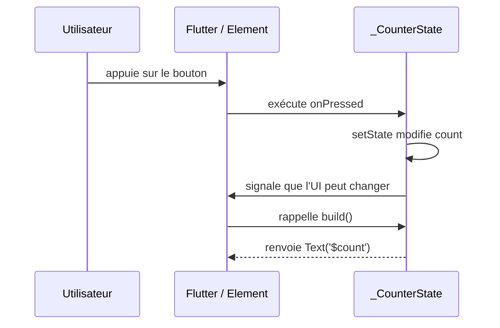

**Navigation :** [← Module 1](./01-notion-etat.md) · [Sommaire](../README.md) · [Module 3 →](./03-cycle-de-vie.md)

# Module 2 — Comprendre `StatelessWidget` et `StatefulWidget`

## 1. Objectif pédagogique

Vous comprendrez la relation entre un widget de configuration et son objet `State`, ainsi que les rôles de `createState`, `initState`, `build`, `setState` et `dispose`.

## 2. Le problème à résoudre

Un compteur doit garder sa valeur entre deux pressions. Un widget qui ne reçoit que des paramètres immuables ne peut pas, à lui seul, retenir cette valeur et signaler qu’elle vient de changer.

## 3. Explication du fonctionnement

Un `StatelessWidget` décrit une UI à partir de ses paramètres et des dépendances ambiantes; il ne possède pas de stockage mutable géré par un `State`. Un `StatefulWidget` est une configuration immutable. Flutter lui associe un objet `State<T>` où vivent les champs qui peuvent changer pendant la durée de vie de cette position dans l’arbre.

Cette séparation permet au framework de remplacer souvent les objets widget (de nouvelles configurations) tout en conservant l’objet `State` approprié. `createState()` fournit le type d’état à créer. `initState()` initialise les ressources propres à cette instance une seule fois. `build()` décrit les widgets visibles et peut être rappelée plusieurs fois. `setState(() { ... })` exécute immédiatement une petite mutation synchrone, puis marque cette partie de l’arbre comme devant être reconstruite. Il ne « dessine » pas lui-même l’écran. `dispose()` libère abonnements, contrôleurs, minuteries ou animations lorsque cet état ne servira plus.

## 4. Petit extrait de code

```dart
class Counter extends StatefulWidget {
  const Counter({super.key});
  @override State<Counter> createState() => _CounterState();
}
class _CounterState extends State<Counter> {
  int count = 0;
  @override Widget build(BuildContext context) => TextButton(
    onPressed: () => setState(() => count++), child: Text('$count'));
}
```

## 5. Explication ligne par ligne

- `Counter` est la configuration immutable; elle ne contient pas le compteur mutable.
- `createState()` demande au framework une instance de `_CounterState` quand il insère ce widget dans l’arbre.
- `count` appartient à cette instance durable de `State`, pas à un nouvel objet `Counter` construit lors de chaque `build`.
- `build` retourne une description de bouton dont le texte est calculé depuis `count`.
- `onPressed` appelle `setState`; son callback met à jour la mémoire, puis Flutter marque l’élément concerné comme « à reconstruire ». Le prochain `build` lit la nouvelle valeur.

## 6. Déroulement interne



`setState` ne remplace pas le `State` : il le garde et recalcule sa description visuelle. Les enfants compatibles peuvent eux aussi être réutilisés selon leur type et leur clé.

## 7. Pourquoi cette approche ?

C’est la solution la plus directe pour l’état local à un seul sous-arbre : animation, sélection d’onglet, visibilité d’un panneau ou brouillon de formulaire. `initState` sert aux initialisations ponctuelles; `dispose` évite les ressources ou abonnements qui continueraient après la disparition du widget. Les dépendances héritées qui doivent pouvoir changer se consultent normalement dans `didChangeDependencies`, pas par abonnement dans `initState`.

## 8. Erreur classique

**Erreur :** lancer une requête, créer un contrôleur ou appeler `setState` à chaque `build`. `build` peut être rappelée souvent. **Correction :** `build` calcule une description sans effet secondaire; initialisez dans le cycle de vie adapté et libérez dans `dispose`.

## 9. Questions de compréhension

1. Pourquoi `count` est-il placé dans `_CounterState` plutôt que dans `Counter`?
2. Quand `setState` modifie `count`, quelle partie est conservée et quelle méthode est rappelée?
3. Pourquoi une future requête asynchrone ne devrait-elle pas être lancée systématiquement dans `build`?
4. Quel type de ressource devrait être libéré dans `dispose`?

## 10. Petit exercice pratique

- **Objectif :** décider si un widget doit être sans état local ou avec un `State`.
- **Situation de départ :** une étoile favorite change de contour à chaque appui, mais aucune autre partie de l’écran ne l’utilise.
- **Résultat attendu :** proposer où stocker le booléen favori et quel signal demande l’actualisation.
- **Consignes :** décrivez la classe de widget, son état initial et l’action de l’appui; ne rédigez pas toute l’application.
- **Critères de réussite :** le booléen ne vit pas dans une variable locale à `build` et l’UI est recalculée après sa mutation.
- **Indice facultatif :** comparez une configuration `StatelessWidget` à un `StatefulWidget` dont le parent ne partage pas cette étoile.

## 11. Résumé essentiel

- Le widget est une configuration; l’objet `State` conserve l’état mutable associé à une position dans l’arbre.
- `createState` crée cet objet; `setState` le signale comme devant reconstruire; `build` décrit l’UI.
- `initState` initialise une fois; `dispose` libère les ressources à la fin de vie.
- `build` peut s’exécuter plusieurs fois : elle doit rester calculable et sans effets secondaires.

## 12. Lien avec le module suivant

Pour bien placer les initialisations et les nettoyages, il faut savoir à quel moment précis l’objet `State` apparaît, change de configuration ou disparaît.
