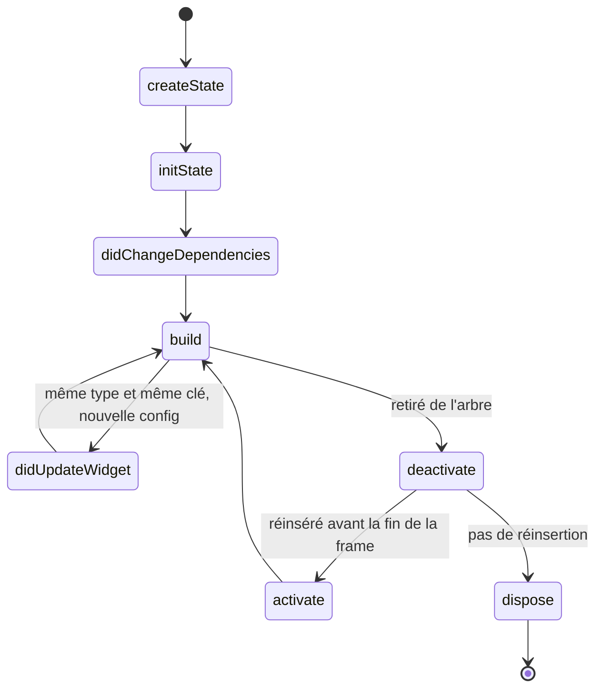

**Navigation :** [← Module 2](./02-stateless-stateful.md) · [Sommaire](../README.md) · [Module 4 →](./04-categories-etat.md)

# Module 3 — Le cycle de vie et les reconstructions

## 1. Objectif pédagogique

Vous distinguerez une reconstruction, une nouvelle instance de widget et la destruction d’un état. Vous saurez à quoi servent les étapes principales du cycle de vie d’un `State`.

## 2. Le problème à résoudre

Un parent transmet un nouveau titre à un widget enfant. Faut-il effacer son brouillon? Son `State` sera-t-il recréé? Et si l’enfant est temporairement déplacé dans l’arbre?

## 3. Explication du fonctionnement

Flutter crée un `State` par insertion d’un `StatefulWidget` dans l’arbre. Après l’association avec un `BuildContext`, `initState()` s’exécute une fois. `didChangeDependencies()` suit cette initialisation, puis peut être rappelée si une dépendance héritée consultée par ce widget change. `build()` peut ensuite être appelée autant de fois que nécessaire.

Si le parent fournit une nouvelle configuration du même type et de même clé à la même position, Flutter réutilise généralement l’`Element` et le `State`, met à jour la propriété `widget`, appelle `didUpdateWidget(ancienneConfiguration)`, puis `build()`. Une nouvelle instance de widget ne signifie donc pas forcément un nouvel état.

Quand l’élément quitte l’arbre, `deactivate()` est appelé. L’élément peut être réinséré ailleurs avant la fin de la frame (par exemple grâce à une `GlobalKey`); il peut alors être activé de nouveau. S’il n’est pas réinséré, `dispose()` marque la fin irréversible : il ne reconstruira plus et il ne faut plus lui envoyer `setState`. Un type ou une clé différente à cette position peut provoquer la destruction de l’ancien état et la création d’un nouveau.

## 4. Petit extrait de code

## 5. Explication ligne par ligne

Le diagramme décrit les transitions et non une liste de méthodes à appeler soi-même. `createState` est appelé par Flutter, pas par votre code d’interface. `didChangeDependencies` sert par exemple à recalculer une valeur dépendant d’un `InheritedWidget`. `didUpdateWidget` sert à réagir à une nouvelle configuration (ou à remplacer un abonnement lié à une propriété fournie par le parent); Flutter appelle ensuite `build` sans qu’un `setState` supplémentaire soit nécessaire. `deactivate` est potentiellement temporaire; si l’élément est replacé, `activate()` précède le `build` suivant; `dispose` est terminal.

## 6. Déroulement interne

Trois choses différentes sont souvent confondues :

1. **Reconstruction :** Flutter rappelle `build` pour obtenir une nouvelle description.
2. **Nouvel objet widget :** le parent peut créer un nouvel objet de configuration immutable.
3. **Nouvel état :** Flutter détruit l’ancien `State` et en crée un nouveau si l’identité d’arbre ne permet pas sa réutilisation.

L’identité pertinente dépend principalement du type concret et de la clé à cette position. Si un contrôleur écoute une propriété du parent, on s’abonne dans `initState`, on compare et remplace l’abonnement dans `didUpdateWidget`, puis on se désabonne dans `dispose`.

## 7. Pourquoi cette approche ?

Le cycle de vie rend les ressources explicites et empêche de traiter toute mise à jour comme une création complète. Cela permet aux animations, contrôleurs et abonnements de survivre aux reconstructions normales. En contrepartie, une ressource mal désabonnée peut créer une fuite mémoire ou tenter de mettre à jour un état déjà détruit.

## 8. Erreur classique

**Erreur :** penser que `build` ne s’exécute qu’une fois, ou utiliser `deactivate` comme si l’état était déjà détruit. **Correction :** rendez `build` répétable; libérez définitivement les ressources dans `dispose`, sauf si une API exige un détachement temporaire particulier.

## 9. Questions de compréhension

1. Le parent crée un nouvel objet widget de même type et de même clé. Pourquoi le `State` peut-il rester le même?
2. Si `didUpdateWidget` s’exécute, que fait Flutter ensuite?
3. Pourquoi `deactivate` n’est-il pas équivalent à `dispose`?
4. Que se passe-t-il si un callback tente `setState` après `dispose`?

## 10. Petit exercice pratique

- **Objectif :** prédire la durée de vie d’un état.
- **Situation de départ :** un écran de tâche garde le texte d’un champ dans un `State`. Le parent change le titre affiché, mais conserve le même type et la même clé de l’enfant.
- **Résultat attendu :** indiquer quelles méthodes peuvent s’exécuter et si le brouillon disparaît nécessairement.
- **Consignes :** écrivez une séquence courte et expliquez le rôle de `didUpdateWidget`.
- **Critères de réussite :** vous séparez mise à jour de configuration et destruction du `State`.
- **Indice facultatif :** une nouvelle configuration n’est pas forcément un nouvel objet d’état.

## 11. Résumé essentiel

- `build` peut être rappelée de nombreuses fois; elle décrit une UI, elle ne définit pas la durée de vie de l’état.
- `didUpdateWidget` intervient quand la configuration associée change mais que l’état est réutilisé.
- `deactivate` peut être suivi d’une réinsertion; `dispose` est terminal.
- Type et clé déterminent une grande partie de la réutilisation dans l’arbre.

## 12. Lien avec le module suivant

Maintenant que l’état local et sa durée de vie sont clairs, nous pouvons classer les états selon leur portée et leur besoin de persistance.
