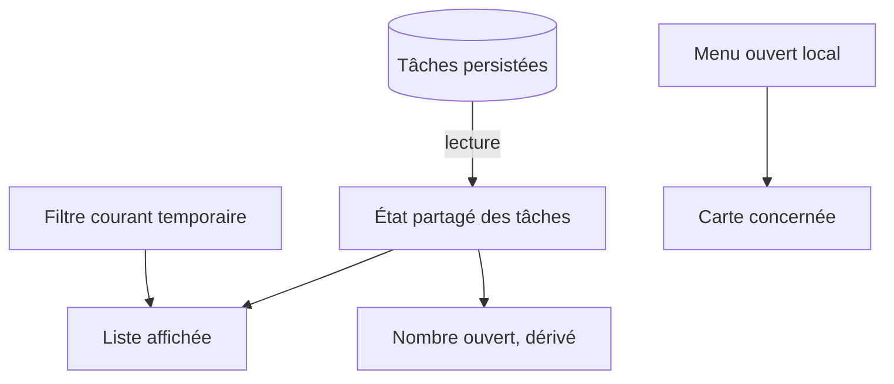

**Navigation :** [← Module 3](./03-cycle-de-vie.md) · [Sommaire](../README.md) · [Module 5 →](./05-remontee-etat.md)

# Module 4 — Les différentes catégories d’état

## 1. Objectif pédagogique

Vous saurez reconnaître un état local, partagé, global, dérivé, persistant ou temporaire, et comprendre pourquoi leur emplacement dépend de leur durée de vie et de leurs lecteurs.

## 2. Le problème à résoudre

Une application de tâches a des projets, des statuts, un filtre courant, une fenêtre ouverte, un brouillon et un nombre de tâches restantes. Les mettre tous dans un unique objet « global » rend les responsabilités confuses.

## 3. Explication du fonctionnement

- **État local :** utile à un widget ou sous-arbre précis, comme l’expansion d’une carte.
- **État partagé :** lu ou modifié par plusieurs widgets, comme le filtre qui affecte à la fois une barre de filtres et la liste.
- **État global d’application :** information pertinente à plusieurs écrans, par exemple la session courante ou la configuration de thème. « Global » ne signifie pas nécessairement variable statique : un fournisseur ou un dépôt a une durée de vie explicite.
- **État dérivé :** calculé depuis une source de vérité, comme le nombre de tâches ouvertes. Le stocker en double risque de le rendre incohérent.
- **État temporaire d’interface :** menu ouvert, texte de recherche en cours, sélection momentanée; il peut disparaître en quittant l’écran.
- **État persistant :** doit survivre à la fermeture ou au redémarrage; il réside dans une base, un fichier ou un service externe.

Une même donnée peut changer de catégorie selon les exigences : un filtre local à un écran est temporaire; si l’application doit le restaurer au prochain lancement, il devient aussi persistant. On choisit le propriétaire qui couvre précisément les consommateurs et la durée de vie nécessaires, pas un unique conteneur pour tout.

## 4. Petit extrait de code

```dart
final openCount = tasks.where((task) => !task.done).length;
```

## 5. Explication ligne par ligne

`tasks` est ici la source de vérité déjà chargée. `where` sélectionne les tâches dont le statut est ouvert; `length` calcule un résultat dérivé. Si `tasks` change, on recalcule `openCount` au lieu de maintenir manuellement un deuxième compteur qui pourrait être oublié après suppression ou modification.

## 6. Déroulement interne



Le schéma présente les responsabilités, pas une obligation d’utiliser un gestionnaire particulier.

## 7. Pourquoi cette approche ?

Un état bien localisé limite les dépendances et les reconstructions inutiles. Les données dérivées restent cohérentes si elles sont recalculées à partir de la source. La persistance doit être décidée selon le besoin utilisateur : sauver chaque détail d’interface peut être inutile ou même surprenant.

## 8. Erreur classique

**Erreur :** stocker à la fois la liste et tous ses compteurs dans un état global mutable. Une suppression peut oublier de décrémenter le compteur. **Correction :** garder la source de vérité et dériver les valeurs simples; persister uniquement ce qui doit survivre.

## 9. Questions de compréhension

1. Où placer l’état « menu de tri ouvert » si un seul widget l’utilise?
2. Pourquoi un total de tâches ouvertes est-il souvent dérivé plutôt que stocké à part?
3. Un filtre partagé par une barre et une liste doit-il forcément être global à toute l’application?
4. Quelle exigence change si le filtre doit être restauré après redémarrage?

## 10. Petit exercice pratique

- **Objectif :** classer des informations d’une page de projet.
- **Situation de départ :** page avec tâches persistées, un filtre par statut, un panneau de détails ouvert et un total « terminées ».
- **Résultat attendu :** une catégorie et un emplacement probable pour chacune.
- **Consignes :** classez les quatre informations; justifiez le besoin ou non de persistance.
- **Critères de réussite :** le total est identifié comme dérivé et le panneau comme état d’interface local, sauf exigence contraire.
- **Indice facultatif :** demandez « qui lit cela? » et « combien de temps faut-il le conserver? ».

## 11. Résumé essentiel

- La portée et la durée de vie guident le propriétaire d’un état.
- Local, partagé et global désignent la portée, pas la nature de la donnée.
- Dériver évite de dupliquer une source de vérité.
- Persistant signifie survivre à la fermeture; ce n’est pas synonyme de « global ».

## 12. Lien avec le module suivant

Lorsqu’un état est utile à plusieurs widgets, il faut leur donner un chemin explicite pour le lire et signaler les actions : c’est la remontée d’état.
