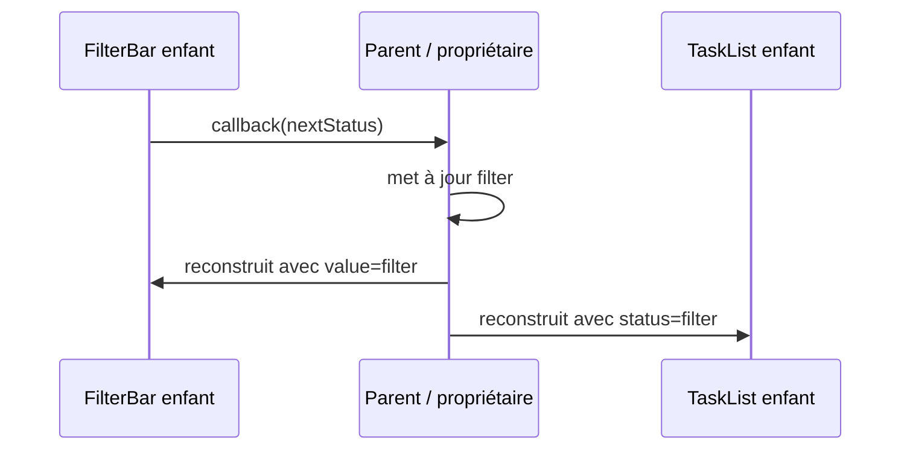

**Navigation :** [← Module 4](./04-categories-etat.md) · [Sommaire](../README.md) · [Module 6 →](./06-solutions-gestion-etat.md)

# Module 5 — La remontée d’état et le passage de données

## 1. Objectif pédagogique

Vous comprendrez le flux descendant des paramètres et le flux remontant des callbacks. Vous saurez pourquoi des widgets frères ne partagent pas spontanément leur état et quand déplacer cet état vers un parent commun.

## 2. Le problème à résoudre

Une barre de filtre et une liste sont deux widgets frères. L’utilisateur choisit « terminées » dans la barre; la liste doit afficher les tâches correspondantes. Si chacun conserve une copie indépendante du filtre, elles peuvent diverger.

## 3. Explication du fonctionnement

Un parent peut posséder `filter`, le passer comme **paramètre** à l’enfant liste et transmettre une fonction **callback** à la barre. L’enfant ne modifie pas directement son frère : il informe le parent de l’intention. Le parent modifie son état puis reconstruit les enfants avec les nouvelles valeurs.

On place l’état au plus petit ancêtre commun de tous les consommateurs nécessaires. C’est la **remontée d’état** (lifting state up). Elle est simple dans un petit sous-arbre, mais peut obliger à faire passer de nombreux paramètres à travers des widgets intermédiaires (« prop drilling ») quand l’arbre s’agrandit. Un mécanisme de portée partagée peut alors être plus pratique.

## 4. Petit extrait de code

```dart
Column(children: [
  FilterBar(value: filter, onChanged: (next) => setState(() => filter = next)),
  TaskList(tasks: tasks, status: filter),
])
```

## 5. Explication ligne par ligne

- `Column` est ici le parent qui contient les deux enfants et qui détient déjà `filter` dans son `State`.
- `FilterBar` reçoit la valeur actuelle et le callback. À la sélection, le parent remplace son état par `next` grâce à `setState`.
- `TaskList` reçoit la même valeur. Au prochain `build`, il peut filtrer/afficher selon le choix courant.
- Les deux widgets ne partagent pas leur mémoire : ils reçoivent tous deux une valeur produite par leur propriétaire commun.

## 6. Déroulement interne



## 7. Pourquoi cette approche ?

Elle donne une source de vérité et des responsabilités lisibles : données vers le bas, intentions vers le haut. Elle convient à quelques widgets proches. Si plusieurs écrans, services ou branches lointaines dépendent des mêmes données, un état partagé fourni par un modèle, un provider ou un autre gestionnaire devient plus simple.

## 8. Erreur classique

**Erreur :** chaque enfant conserve son filtre local et tente de synchroniser l’autre. Cela crée deux sources modifiables. **Correction :** remonter la valeur au parent commun, ou choisir une solution de partage lorsque le parent devient trop éloigné.

## 9. Questions de compréhension

1. Pourquoi la barre de filtre ne devrait-elle pas modifier directement l’objet `State` de la liste?
2. Quelle donnée descend du parent et quel signal remonte de l’enfant?
3. Où placer `filter` si trois widgets frères doivent tous réagir au même choix?
4. Quel coût apparaît quand l’état traverse de nombreux parents qui ne l’utilisent pas?

## 10. Petit exercice pratique

- **Objectif :** concevoir un flux parent-enfants.
- **Situation de départ :** un parent affiche un compteur et contient un bouton « + » ainsi qu’un texte de valeur.
- **Résultat attendu :** le parent est l’unique propriétaire du compteur; le bouton envoie une intention; le texte reçoit la valeur.
- **Consignes :** indiquez les deux paramètres à transmettre et l’endroit où se produit la mutation.
- **Critères de réussite :** le bouton n’accède pas directement au `State` du texte; une seule source de vérité existe.
- **Indice facultatif :** utilisez le même raisonnement que `FilterBar` et `TaskList`.

## 11. Résumé essentiel

- Les paramètres transmettent les données du parent vers l’enfant.
- Les callbacks transmettent les intentions vers le propriétaire de l’état.
- Deux frères n’ont pas d’état partagé implicite.
- Le parent commun est une bonne solution locale; un arbre profond peut justifier un mécanisme plus adapté.

## 12. Lien avec le module suivant

La remontée d’état fonctionne à petite échelle. Le prochain module compare les mécanismes conçus pour distribuer et notifier des changements à plus grande portée.
