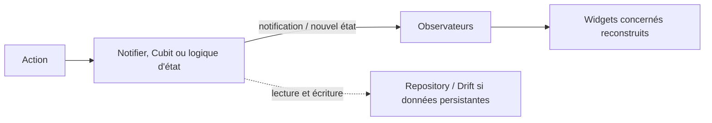

**Navigation :** [← Module 5](./05-remontee-etat.md) · [Sommaire](../README.md) · [Module 7 →](./07-flux-reactivite.md)

# Module 6 — Comprendre les solutions de gestion d’état

## 1. Objectif pédagogique

Vous distinguerez les outils qui conservent un état, ceux qui le rendent accessible, et ceux qui avertissent les observateurs. Vous saurez choisir une approche proportionnée plutôt que chercher une solution universelle.

## 2. Le problème à résoudre

Un compteur local est facile avec `setState`. Une liste utilisée dans plusieurs écrans nécessite un partage plus organisé. Un flux de connexion, un panier et des erreurs asynchrones peuvent en plus demander des transitions prévisibles et testables.

## 3. Explication du fonctionnement

| Approche | Mécanisme conceptuel | Atouts | Limites / contexte |
|---|---|---|---|
| `setState` | Le `State` modifie ses champs et marque son sous-arbre comme pouvant changer. | Natif, direct, excellent pour une interaction locale. | Peu adapté à des données partagées entre branches ou couches. |
| `InheritedWidget` | Un ancêtre immutable expose une valeur; un descendant qui la lit comme dépendance est reconstruit si l’ancêtre signale une différence (`updateShouldNotify`). | Brique Flutter intégrée pour la portée descendante. | Plus de code et de décisions de cycle de vie si on l’écrit à la main. |
| `InheritedNotifier` | Un `InheritedWidget` écoute un objet `Listenable` et réveille ses descendants dépendants quand celui-ci notifie. | Relie une notification à une portée dans l’arbre. | Il faut choisir et gérer le notifier; diffusion trop large possible. |
| `ChangeNotifier` | Classe Flutter qui conserve des champs et appelle `notifyListeners()` après une mutation. Les écouteurs sont avertis. | Petit modèle testable sans widget; efficace pour une logique simple. | Ne fournit pas à lui seul la mise à disposition, le chargement asynchrone ou la persistance. |
| `Provider` | Paquet qui rend une valeur disponible dans une branche, souvent via `InheritedWidget`; ses variantes écoutent `Listenable`, `Future` ou `Stream`. | Réduit le code de portée, facilite création/libération et lecture. | La portée dépend de l’arbre; une erreur de niveau peut rendre la dépendance inaccessible. |
| Riverpod | Système distinct de providers, avec un graphe de dépendances lu par `ref.watch`; il peut fonctionner hors d’un `BuildContext` widget et propose test/overrides. | Composition, gestion des états asynchrones, tests et portée structurés. | API et vocabulaire supplémentaires; il faut apprendre son cycle de vie et sélectionner ses providers. |
| Cubit / BLoC | Un Cubit expose des méthodes qui émettent un nouvel état; un BLoC reçoit des événements typés et produit des états via des handlers. L’UI écoute le flux d’états. | Transitions explicites et testables; BLoC rend les événements traçables. | Plus de structure et de code; excessif pour un bouton isolé. |

Les distinctions sont fondamentales : **Provider est surtout un mécanisme de mise à disposition/lecture**; **ChangeNotifier est un mécanisme de notification**; Provider peut exposer un ChangeNotifier, mais ce ne sont pas des synonymes. **Riverpod définit son propre système de providers**, sans être le paquet `provider`. **BLoC/Cubit organise les changements d’état** autour d’une logique de transition; ce n’est pas simplement un autre nom pour `notifyListeners`.

`InheritedWidget` est intégré à Flutter; `Provider` simplifie son usage. `InheritedNotifier` est une combinaison intégrée entre portée héritée et objet qui notifie. Riverpod peut être vu comme une autre architecture de composition d’état/dépendances. Les outils peuvent coexister si leurs responsabilités sont claires, mais multiplier les systèmes pour une même donnée complique le raisonnement.

## 4. Petit extrait de code

```dart
class TaskCounter extends ChangeNotifier {
  int open = 0;
  void addTask() { open++; notifyListeners(); }
}
```

## 5. Explication ligne par ligne

- `TaskCounter` conserve une valeur et peut avertir des écouteurs; il ne sait pas quels widgets l’affichent.
- `addTask` modifie la mémoire. Sans notification, un écouteur n’a pas de raison de lire la nouvelle valeur.
- `notifyListeners()` diffuse une notification aux abonnés. Un widget exposé/écouté via Provider peut alors être reconstruit. La notification ne sauvegarde rien dans SQLite.

## 6. Déroulement interne



Le trajet exact varie : Provider peut écouter un `ChangeNotifier`, Riverpod suit des providers avec `ref.watch`, et BLoC expose un flux de nouveaux états. `setState` notifie directement le `State` local sans ajouter un gestionnaire externe.

## 7. Pourquoi cette approche ?

Choisissez selon **portée**, **complexité des transitions**, **asynchronisme**, **besoin de tests** et **connaissances de l’équipe**. Une page de formulaire peut rester en `setState`; un objet simple partagé peut utiliser ChangeNotifier + Provider; un graphe de dépendances ou des états asynchrones peuvent justifier Riverpod; une série d’événements métier traçables peut justifier BLoC. Le coût est l’apprentissage, la configuration et la discipline architecturale.

## 8. Erreur classique

**Erreur :** dire « Provider est la notification » ou « Riverpod est une version de ChangeNotifier ». **Correction :** séparer la valeur, son mécanisme de notification, sa mise à disposition dans l’application et la règle qui transforme une action en nouvel état.

## 9. Questions de compréhension

1. Pourquoi `notifyListeners()` ne suffit-il pas à rendre un objet accessible à un widget lointain?
2. Que simplifie Provider par rapport à l’écriture manuelle d’un `InheritedWidget`?
3. Quelle différence conceptuelle existe entre un événement BLoC et une méthode de Cubit?
4. Une application avec un seul panneau local a-t-elle besoin d’un gestionnaire global? Pourquoi?

## 10. Petit exercice pratique

- **Objectif :** choisir une solution sans surarchitecturer.
- **Situation de départ :** (A) état d’un accordéon unique; (B) thème utilisé partout; (C) procédure de paiement avec états chargement/réussite/échec et événements journalisés.
- **Résultat attendu :** proposer pour chaque situation une approche plausible et expliquer les compromis.
- **Consignes :** choisissez parmi `setState`, `InheritedWidget`/Provider + `ChangeNotifier`, Riverpod et BLoC/Cubit; une autre réponse argumentée est acceptable.
- **Critères de réussite :** vous reliez chaque choix à la portée et à la complexité, pas à la popularité.
- **Indice facultatif :** la meilleure réponse pour A peut être plus simple que celle pour C.

## 11. Résumé essentiel

- Une stratégie d’état n’est pas forcément un stockage durable.
- `ChangeNotifier` notifie; Provider rend une dépendance accessible; Riverpod a son système propre.
- `setState` reste approprié pour l’état local.
- BLoC/Cubit structure des transitions au prix d’une architecture plus explicite.

## 12. Lien avec le module suivant

Toutes ces approches ont besoin d’un mécanisme de notification ou de diffusion. Pour comprendre les listes qui changent dans le temps, il faut distinguer une valeur unique d’un flux de valeurs.
