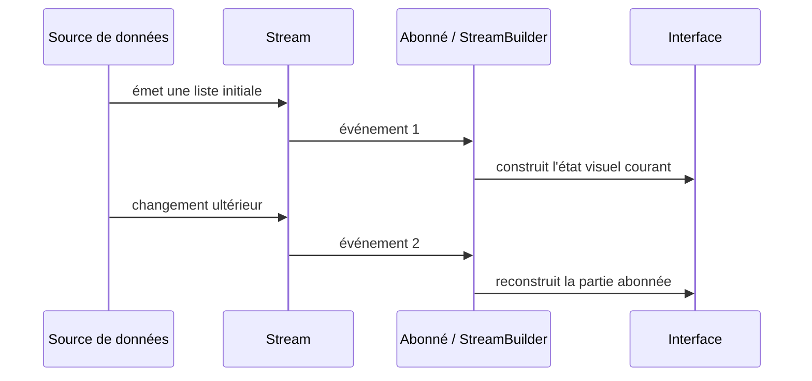

**Navigation :** [← Module 6](./06-solutions-gestion-etat.md) · [Sommaire](../README.md) · [Module 8 →](./08-architecture.md)

# Module 7 — Flux de données et programmation réactive

## 1. Objectif pédagogique

Vous comprendrez un observateur, une notification, `Future` et `Stream`, ainsi que la raison pour laquelle un widget peut réagir automatiquement à des valeurs asynchrones successives.

## 2. Le problème à résoudre

Un chargement initial peut produire une liste de tâches une fois. Mais une liste doit aussi réagir à une tâche ajoutée ou modifiée plus tard, sans que l’écran interroge en boucle la base.

## 3. Explication du fonctionnement

Un **observateur** est un composant inscrit pour recevoir les changements d’une source. Une **notification** annonce qu’il faut réexaminer une valeur. Une **valeur** est un instantané; un **flux de données** est une suite d’événements potentiels dans le temps.

En Dart, un `Future<T>` représente le résultat d’une opération asynchrone qui se termine une fois (succès avec `T` ou erreur). Un `Stream<T>` peut émettre zéro, une ou plusieurs valeurs et ensuite se terminer ou continuer. On écoute un Stream par abonnement, que l’on arrête lorsqu’il n’est plus nécessaire. Un `StreamBuilder` relie un flux à l’UI : chaque nouvelle émission met à jour son instantané puis son sous-arbre est reconstruit.

La **programmation réactive** consiste ici à déclarer « cette interface dépend de cette source » : la source publie de nouvelles valeurs et les observateurs réagissent. Ce n’est pas une propriété automatique de toutes les variables; il faut un canal observable et un abonné.

## 4. Petit extrait de code

```dart
Future<Task> loadTask(int id);       // un résultat ponctuel
Stream<List<Task>> watchTasks();     // des instantanés successifs
```

## 5. Explication ligne par ligne

- `Future<Task>` indique qu’un appel à `loadTask` finira par donner un résultat unique : par exemple une tâche chargée ou une erreur.
- `Stream<List<Task>>` indique qu’un abonné peut recevoir plusieurs instantanés de la liste au fil du temps. À chaque émission, ce n’est pas nécessairement un « delta »; il peut s’agir de toute la liste courante.
- Ces signatures décrivent le contrat asynchrone. Elles ne disent pas par elles-mêmes qui est abonné ni comment l’écran présente chargement et erreur.

## 6. Déroulement interne



`FutureBuilder` convient à un résultat ponctuel; `StreamBuilder` à des mises à jour successives. Les deux exposent les états d’attente/réussite/erreur selon leurs snapshots.

## 7. Pourquoi cette approche ?

Un flux évite le polling manuel et permet de composer des sources vivantes : base locale, capteur ou socket. La limite est qu’il faut considérer les erreurs, l’abonnement, la fréquence des événements et la fermeture. Un flux trop large ou coûteux peut déclencher des reconstructions inutiles.

## 8. Erreur classique

**Erreur :** confondre un `Future` de chargement avec un flux qui reste à jour, ou créer un nouveau Stream dans chaque `build`. **Correction :** choisir le contrat adapté et conserver le Stream à un endroit stable afin qu’une reconstruction ne redémarre pas inutilement l’abonnement.

## 9. Questions de compréhension

1. Une opération qui lit un fichier une seule fois doit-elle retourner un `Future` ou un `Stream`? Pourquoi?
2. Si une requête émet la liste entière après une insertion, s’agit-il forcément d’un événement contenant seulement la ligne ajoutée?
3. Qu’est-ce qui déclenche le nouveau calcul visuel lorsqu’un Stream émet?
4. Pourquoi un abonnement doit-il avoir une durée de vie définie?

## 10. Petit exercice pratique

- **Objectif :** choisir le contrat asynchrone.
- **Situation de départ :** une fonction lit une préférence au démarrage; une autre surveille la liste de tâches pendant que l’écran est visible.
- **Résultat attendu :** choisir `Future` pour la lecture unique et `Stream` pour l’observation continue.
- **Consignes :** dessinez les producteurs, abonnés et nombres d’émissions possibles.
- **Critères de réussite :** vous distinguez valeur initiale et changements successifs.
- **Indice facultatif :** demandez si la source doit continuer à envoyer des mises à jour après le premier résultat.

## 11. Résumé essentiel

- `Future` termine une opération ponctuelle; `Stream` transporte des événements successifs.
- Un observateur ne voit une mise à jour que s’il est abonné à une source qui la notifie.
- `StreamBuilder` transforme les émissions en reconstructions d’UI.
- La réactivité a un coût de cycle de vie, d’erreurs et de fréquence à gérer.

## 12. Lien avec le module suivant

Les flux nous donnent le mécanisme de mise à jour. Il reste à organiser qui prend les décisions métier et qui accède réellement aux données.
