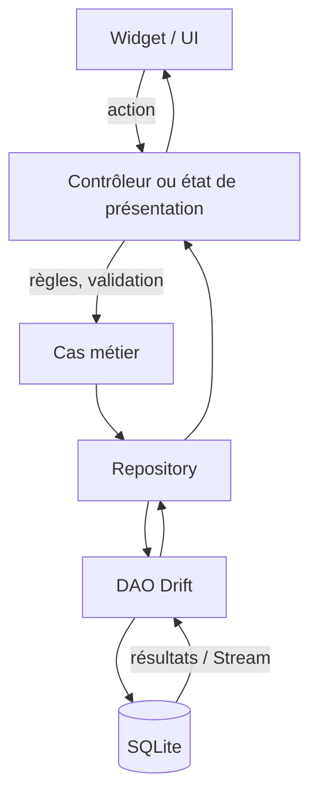

**Navigation :** [← Module 7](./07-flux-reactivite.md) · [Sommaire](../README.md) · [Module 9 →](./09-stockage-local-sqlite.md)

# Module 8 — Choisir une architecture de gestion d’état

## 1. Objectif pédagogique

Vous saurez séparer UI, état de présentation, logique métier, accès aux données et opérations asynchrones, sans construire une architecture lourde pour un exemple minuscule.

## 2. Le problème à résoudre

Un bouton « ajouter tâche » peut à la fois vérifier un titre, afficher un indicateur, écrire directement une requête et mettre à jour une liste dans un widget. Lorsque la règle change, plusieurs responsabilités deviennent difficiles à tester et à modifier.

## 3. Explication du fonctionnement

- **UI / présentation :** affiche les données et transmet les intentions de l’utilisateur.
- **État de présentation :** filtre, chargement, erreurs et sélection nécessaires à l’écran.
- **Logique métier :** décide ce que signifie « ajouter une tâche valide », quelles règles s’appliquent et quelle opération doit avoir lieu.
- **Repository (dépôt) :** interface d’accès aux données qui masque leur origine et peut coordonner plusieurs sources.
- **DAO (objet d’accès aux données) :** regroupe les requêtes concrètes liées à une ou plusieurs tables.
- **Opérations asynchrones :** lecture/écriture via `Future` ou `Stream`; elles ne doivent pas figer le thread d’interface.

Pour une petite page, un widget et un repository peuvent suffire. Quand les cas métier augmentent, extraire des responsabilités permet de tester les règles sans construire une UI, et de changer l’implémentation de stockage sans réécrire les widgets.

## 4. Petit extrait de code

```dart
abstract interface class TaskRepository {
  Stream<List<Task>> watchTasks();
  Future<void> addTask(String title);
}
```

## 5. Explication ligne par ligne

- `TaskRepository` décrit une interface de capacité, pas une base de données précise.
- `watchTasks` expose les données courantes et leurs changements au moyen d’un contrat réactif.
- `addTask` représente une intention d’écriture asynchrone. Une implémentation réelle pourra valider puis déléguer à Drift.
- L’UI peut dépendre de cette abstraction; la classe Drift concrète est injectée à un niveau supérieur.

## 6. Déroulement interne



Le flux descendant déclenche les opérations; le flux retour transporte résultat, chargement, erreur ou nouvelle liste.

## 7. Pourquoi cette approche ?

Elle réduit le couplage entre écran et persistance, clarifie les règles et rend les tests ciblés. Une abstraction peut toutefois devenir du boilerplate si elle ne masque rien d’utile. Il ne faut pas créer plusieurs couches simplement pour suivre un diagramme : leur bénéfice doit être observable.

## 8. Erreur classique

**Erreur :** placer toutes les règles et requêtes dans `build`. Chaque reconstruction risque de relancer un effet de bord, et les décisions métier deviennent difficiles à tester. **Correction :** `build` décrit; un gestionnaire reçoit l’action; un repository/DAO lit ou écrit.

## 9. Questions de compréhension

1. Si l’écran ne doit pas connaître Drift, quelle interface peut-il appeler pour charger les tâches?
2. Qui devrait décider qu’un titre vide est refusé : le widget, le dépôt ou une règle métier? Pourquoi?
3. Quel élément expose la requête SQL concrète?
4. Quel risque apparaît si une écriture est lancée directement dans `build`?

## 10. Petit exercice pratique

- **Objectif :** tracer la responsabilité d’un ajout.
- **Situation de départ :** l’utilisateur saisit « Préparer la présentation » et appuie sur Ajouter.
- **Résultat attendu :** UI → logique de présentation/métier → repository/DAO → base, puis retour du résultat.
- **Consignes :** associez à chaque couche une action unique et indiquez où l’erreur de titre vide est traitée.
- **Critères de réussite :** la base n’est pas appelée depuis `build`, et l’UI ne contient pas la requête SQL.
- **Indice facultatif :** réutilisez le diagramme de ce module.

## 11. Résumé essentiel

- L’UI affiche et transmet des intentions; elle n’a pas besoin de posséder toutes les règles.
- Le repository masque l’accès aux données; le DAO regroupe les requêtes concrètes.
- Les opérations asynchrones et leurs erreurs font partie de l’état présenté.
- Une architecture doit rester proportionnée au besoin.

## 12. Lien avec le module suivant

La couche de données peut être une mémoire, un fichier, une base locale ou un serveur. Nous allons examiner pourquoi des tâches à conserver demandent autre chose qu’une variable.

# PARTIE II — COMPRENDRE LE STOCKAGE LOCAL AVEC DRIFT
