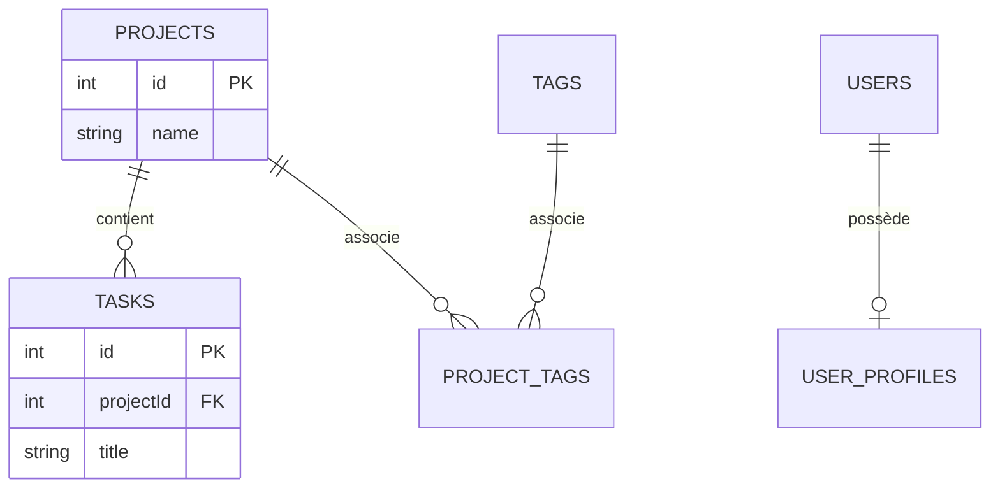

**Navigation :** [← Module 13](./13-contraintes.md) · [Sommaire](../README.md) · [Module 15 →](./15-crud.md)

# Module 14 — Créer les tables et comprendre les relations

## 1. Objectif pédagogique

Vous saurez représenter les relations un-à-plusieurs, un-à-un et plusieurs-à-plusieurs, créer une table de liaison et anticiper suppressions en cascade et références orphelines.

## 2. Le problème à résoudre

Un projet contient plusieurs tâches, mais une tâche appartient au plus à un projet. Si on supprime un projet, il faut décider si ses tâches sont supprimées, conservées sans projet ou si la suppression est empêchée.

## 3. Explication du fonctionnement

Dans une relation **un-à-plusieurs**, la table du côté « plusieurs » garde une clé étrangère vers la table « un ». Le `projectId` de chaque tâche référence la clé d’un projet. Une relation **un-à-un** est généralement une clé étrangère à laquelle on ajoute une contrainte unique. Pour une relation **plusieurs-à-plusieurs**, on crée une **table de liaison** contenant une paire de clés étrangères; cette table peut aussi porter des attributs (date d’association, ordre, rôle).

Une référence sans cible est une donnée orpheline. Une action `CASCADE` supprime les lignes dépendantes; elle est pratique quand l’enfant n’a aucun sens sans le parent, mais dangereuse si la suppression du parent était accidentelle. `RESTRICT` empêche la suppression tant qu’il reste des références. `SET NULL` conserve l’enfant et retire son association, donc la colonne doit accepter `NULL`.

SQLite peut avoir les clés étrangères désactivées par défaut selon la connexion. Avec Drift, configurez-les explicitement, typiquement dans `beforeOpen` de `MigrationStrategy`, avec `PRAGMA foreign_keys = ON`, puis testez que l’exécuteur l’applique.

## 4. Petit extrait de code

```dart
class Projects extends Table {
  IntColumn get id => integer().autoIncrement()();
  TextColumn get name => text()();
}
class Tasks extends Table {
  IntColumn get id => integer().autoIncrement()();
  IntColumn get projectId => integer()
      .references(Projects, #id, onDelete: KeyAction.cascade)();
  TextColumn get title => text()();
}
```

## 5. Explication ligne par ligne

- `Projects.id` fournit l’identifiant cible.
- `Tasks.id` identifie séparément chaque tâche.
- `Tasks.projectId` est une référence à `Projects.id`; sans `nullable()`, chaque tâche doit avoir un projet.
- `onDelete: KeyAction.cascade` exprime le choix métier de supprimer les tâches dépendantes si leur projet est supprimé. Remplacez-le par une règle restrictive ou une autre politique si la conservation est attendue.
- Pour qu’une base SQLite applique cette relation, activez les foreign keys comme indiqué dans le module; la déclaration Dart seule ne suffit pas à corriger une connexion configurée sans elles.

## 6. Déroulement interne



Le diagramme montre aussi qu’un un-à-un peut être représenté par `USER_PROFILES.userId` unique, et que le plusieurs-à-plusieurs Projects/Tags passe par `PROJECT_TAGS(projectId, tagId)` avec clé primaire composée. Une suppression en cascade sur ces deux références enlèverait les associations, pas nécessairement les projets et tags eux-mêmes.

## 7. Pourquoi cette approche ?

La normalisation (stocker l’identifiant de relation une seule fois) facilite les recherches, jointures et contraintes d’intégrité. La table de liaison évite de répéter des listes d’identifiants dans une colonne. Les cascades simplifient les suppressions intentionnelles; les restrictions protègent mieux les données critiques. Une clé étrangère côté enfant peut aussi mériter un index pour accélérer les recherches ou suppressions parentales.

## 8. Erreur classique

**Erreur :** stocker les projets d’une tâche sous forme de texte libre ou supprimer le parent en oubliant les enfants. **Correction :** créer une FK, activer la vérification et choisir explicitement la politique de suppression selon le cycle de vie des données.

## 9. Questions de compréhension

1. Dans une relation projet-tâches, quelle table porte la clé étrangère et pourquoi?
2. Comment imposer qu’une tâche ne soit associée qu’à un seul profil et inversement?
3. Pourquoi une association projet-étiquette avec des propriétés propres mérite-t-elle une table?
4. Quel risque distingue `CASCADE` de `RESTRICT`?

## 10. Petit exercice pratique

- **Objectif :** modéliser Projet–Tâche et Projet–Étiquette.
- **Situation de départ :** un projet possède plusieurs tâches et plusieurs étiquettes; une étiquette peut servir à plusieurs projets.
- **Résultat attendu :** FK `Tasks.projectId` et table de liaison `ProjectTags` avec deux références.
- **Consignes :** indiquez la clé primaire de la table de liaison et une action de suppression raisonnable.
- **Critères de réussite :** la relation plusieurs-à-plusieurs n’est pas mise dans une chaîne JSON de projets.
- **Indice facultatif :** la paire `(projectId, tagId)` peut être unique.

## 11. Résumé essentiel

- Un-à-plusieurs : la clé étrangère vit côté « plusieurs ».
- Un-à-un : une FK avec unicité assure la cardinalité.
- Plusieurs-à-plusieurs : table de liaison, souvent avec clé primaire composée.
- `CASCADE`, `RESTRICT` et `SET NULL` sont des politiques métier; activez/testez les FKs SQLite.

## 12. Lien avec le module suivant

Les tables et relations sont définies; le module suivant utilise ces tables pour effectuer les quatre opérations de base : CRUD.
