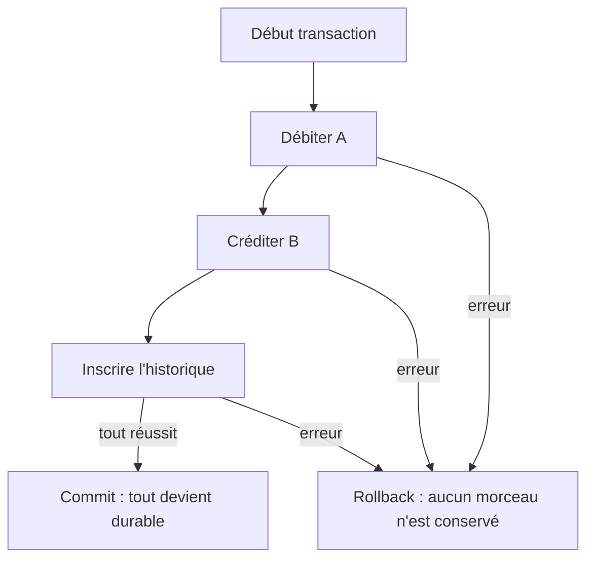

**Navigation :** [← Module 17](./17-types-donnees.md) · [Sommaire](../README.md) · [Module 19 →](./19-index.md)

# Module 18 — Transactions et cohérence des données

## 1. Objectif pédagogique

Vous comprendrez pourquoi plusieurs requêtes doivent parfois réussir ou échouer ensemble et comment une transaction Drift protège la cohérence d’une opération métier.

## 2. Le problème à résoudre

Un transfert débite un compte A, crédite un compte B et crée un historique. Si l’application s’arrête après le débit mais avant le crédit, les données décrivent une opération impossible.

## 3. Explication du fonctionnement

Une **transaction** est une unité d’opérations exécutée de façon atomique : la base valide l’ensemble ou annule les changements si une erreur survient. Les propriétés **ACID** sont :

- **Atomicité :** tout ou rien.
- **Cohérence :** les contraintes et règles restent respectées avant et après.
- **Isolation :** les opérations concurrentes ne doivent pas observer un état intermédiaire invalide (les garanties exactes dépendent du moteur/configuration).
- **Durabilité :** après validation, les changements validés résistent aux arrêts ordinaires selon les garanties/configurations du moteur et de la plateforme.

Une transaction n’est pas nécessaire pour toute requête indépendante. Elle le devient lorsque plusieurs écritures forment une seule décision métier : créer une vente et ses lignes, affecter plusieurs tâches, ou modifier deux soldes. Si un `throw` ou une erreur survient dans le callback, Drift annule la transaction et transmet l’erreur. Les effets externes (envoyer un courriel, appeler un serveur) ne sont pas annulés par SQLite.

## 4. Petit extrait de code

```dart
await transaction(() async {
  await debit(fromAccount, amount);
  await credit(toAccount, amount);
  await recordTransfer(fromAccount, toAccount, amount);
});
```

## 5. Explication ligne par ligne

- `transaction` ouvre une unité atomique sur la connexion Drift.
- `debit`, `credit` et `recordTransfer` sont ici des opérations d’écriture de la même base; elles doivent utiliser cette même instance/transaction.
- Si toutes les futures terminent normalement, la transaction est validée.
- Si l’une échoue ou si le callback lance une exception, les écritures de ce bloc sont annulées; le code appelant doit encore gérer l’erreur.

## 6. Déroulement interne



## 7. Pourquoi cette approche ?

Elle empêche un état partiel et protège la logique métier quand le processus s’interrompt au mauvais moment. Les transactions doivent rester courtes : pas de requête réseau longue ni d’attente utilisateur à l’intérieur, car elles gardent des ressources et peuvent bloquer d’autres opérations.

## 8. Erreur classique

**Erreur :** exécuter trois écritures indépendantes en pensant que « les appeler l’une après l’autre » les rend atomiques. **Correction :** entourer les écritures liées dans `transaction`, puis lever une erreur si une précondition échoue. Une transaction ne valide pas automatiquement toute règle métier : celle-ci doit être vérifiée.

## 9. Questions de compréhension

1. Que reste-t-il si le débit réussit mais que le crédit échoue dans une transaction?
2. Pourquoi ne faut-il pas appeler un serveur lent à l’intérieur d’une transaction locale?
3. La propriété « atomicité » est-elle identique à « durabilité »?
4. Une transaction rend-elle vraie une règle métier qu’on a oublié de vérifier?

## 10. Petit exercice pratique

- **Objectif :** décider d’une frontière de transaction.
- **Situation de départ :** une vente écrit une ligne d’en-tête puis trois lignes d’articles; les totaux doivent correspondre.
- **Résultat attendu :** un seul bloc transactionnel pour l’en-tête et les lignes.
- **Consignes :** indiquez ce qui déclenche le rollback et quelle opération externe ne peut pas être annulée par SQLite.
- **Critères de réussite :** vous placez toutes les écritures constitutives ensemble et excluez le réseau de la transaction.
- **Indice facultatif :** la vente sans ses lignes n’a pas de sens métier.

## 11. Résumé essentiel

- Une transaction regroupe des opérations liées en une unité atomique.
- ACID décrit atomicité, cohérence, isolation et durabilité.
- Une erreur à l’intérieur du callback permet un rollback des écritures SQLite concernées.
- Le réseau et les autres effets externes ne sont pas annulés par la transaction locale.

## 12. Lien avec le module suivant

Les transactions protègent les écritures; le prochain module étudie comment accélérer les lectures fréquentes grâce aux index, sans ralentir inutilement toutes les modifications.
