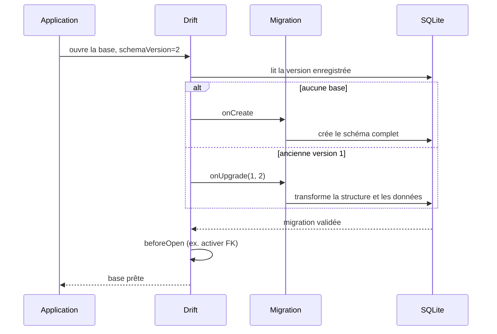

**Navigation :** [← Module 19](./19-index.md) · [Sommaire](../README.md) · [Module 21 →](./21-requetes-reactives.md)

# Module 20 — Les migrations de base de données

## 1. Objectif pédagogique

Vous comprendrez pourquoi chaque évolution du schéma doit être versionnée, comment Drift distingue création et mise à niveau, comment préserver les données et comment tester plusieurs chemins historiques.

## 2. Le problème à résoudre

La version 1 de l’application a déjà créé `tasks(id, title)` sur le téléphone d’un utilisateur. La version 2 ajoute `priority`. Modifier la classe Dart aide la génération, mais le fichier SQLite existant ne se transforme pas tout seul; sans migration, les requêtes attendent une colonne absente.

## 3. Explication du fonctionnement

Le **schéma** est la structure matérialisée des tables, colonnes, contraintes, références, index, vues et déclencheurs. Une **version de schéma** est un nombre monotone déclaré via `schemaVersion`. À l’ouverture, Drift compare la version enregistrée dans la base avec celle du code et appelle sa **MigrationStrategy**.

- `onCreate` s’exécute pour une base neuve; on y crée le schéma complet (`m.createAll()`).
- `onUpgrade` traite une base existante dont la version diffère. Il reçoit `from` et `to`; il doit exécuter chaque changement utile aux utilisateurs qui sautent plusieurs versions.
- `beforeOpen` s’exécute après création/migration et avant les autres requêtes; il peut configurer `PRAGMA foreign_keys = ON`, valider le schéma en debug ou remplir des valeurs initiales conditionnelles.
- Dans l’API Drift actuelle documentée, il n’y a pas de callback séparé `onDowngrade` dans `MigrationStrategy`; les changements de version (upgrade et downgrade selon la référence API) passent par `onUpgrade` avec `from`/`to`. Décidez explicitement si un downgrade est pris en charge ou rejeté; ne supposez pas qu’il est sans perte.

**Flux recommandé pour migrations guidées :** configurez `build.yaml` pour nommer la base et son fichier; exécutez `dart run drift_dev make-migrations` pour enregistrer le schéma initial; conservez ces snapshots dans le dépôt. Après changement, régénérez le code avec `dart run build_runner build`, augmentez `schemaVersion`, puis relancez `dart run drift_dev make-migrations`. Drift peut générer une fonction `stepByStep` et des tests. La commande initiale établit une référence; la commande après évolution compare et documente un nouveau schéma. Les migrations manuelles restent possibles mais demandent plus de vigilance.

Exemples de changements :

| Évolution | Ancien → nouveau schéma | Migration à prévoir et risque |
|---|---|---|
| Ajouter une colonne nullable | `tasks(id,title)` → + `dueDate NULL` | `m.addColumn(...)`; anciennes lignes ont `NULL`. |
| Ajouter une colonne obligatoire | même table → `priority NOT NULL` | Fournir un défaut acceptable ou reconstruire la table et calculer une valeur pour chaque ancienne ligne; une colonne sans valeur pour les anciennes lignes ne peut pas être imposée naïvement. |
| Créer une table | v1 n’a pas `projects`, v2 l’ajoute | `m.createTable(schema.projects)`; décider si les tâches existantes restent sans projet ou sont affectées. |
| Supprimer une colonne/table | ancien champ/table retiré | Rebuild ou suppression; données perdues si elles ne sont pas copiées. Exporter/transformer d’abord si nécessaire. |
| Renommer une colonne/table | `oldName` devient `newName` | Renommer explicitement ou reconstruire et copier; un simple renommage de getter Dart ne garantit pas un renommage physique SQL. Vérifier vues, FK et index. |
| Modifier type/contrainte | texte numérique devient entier, ou `CHECK` ajouté | `TableMigration` avec `columnTransformer`/`newColumns` si nécessaire; conversion peut échouer et un `CHECK` peut rejeter les anciennes lignes. |
| Modifier relations/index | FK ou index change | Migrer les tables dépendantes dans le bon ordre; recréer index/vues concernées; vérifier l’intégrité étrangère après migration. |

Une modification de table complexe dans SQLite suit souvent une procédure de création de nouvelle table, copie/transformation des lignes, remplacement de l’ancienne. L’API Drift `TableMigration` automatise une grande partie de cette procédure. Pour ajouter une colonne nullable, `m.addColumn` suffit souvent; pour convertir un type, renommer, supprimer ou changer des contraintes, une reconstruction avec `columnTransformer` peut être nécessaire. Si des valeurs doivent être calculées (par exemple transformer un statut texte en code), la migration doit les produire, pas simplement changer la déclaration. Certaines modifications de `withDefault` changent aussi le schéma; `clientDefault` est un défaut Dart qui ne modifie pas le SQL.

## 4. Petit extrait de code

Extrait conceptuel de migration guidée (le fichier `.steps.dart`/schémas est généré et importé) :

```dart
@override
int get schemaVersion => 2;
@override
MigrationStrategy get migration => MigrationStrategy(
  onCreate: (m) => m.createAll(),
  onUpgrade: stepByStep(
    from1To2: (m, schema) async {
      await m.addColumn(schema.tasks, schema.tasks.priority);
    },
  ),
);
```

## 5. Explication ligne par ligne

- `schemaVersion => 2` annonce le nouveau schéma à Drift; augmenter ce nombre sans migration ne transforme pas magiquement les tables.
- `onCreate` crée toutes les tables à jour pour les nouvelles installations.
- `onUpgrade` reçoit la fonction guidée générée et orchestre les étapes manquantes.
- `from1To2` décrit précisément le passage de l’ancien schéma v1 au nouveau v2.
- `schema.tasks.priority` désigne la colonne cible dans le snapshot schema v2. L’ajout est sûr pour des lignes historiques seulement si la colonne est nullable ou si la stratégie fournit une valeur/donnée correcte.

## 6. Déroulement interne



SQLite applique les modifications à la base existante; la table Dart décrit seulement la cible attendue. C’est pourquoi modifier une classe source sans version ni migration casse potentiellement les appareils déjà installés.

## 7. Pourquoi cette approche ?

Une migration conserve l’identité et les données de l’utilisateur tout en faisant évoluer la structure. La suppression/récréation peut convenir à une base jetable pendant le développement local, pas comme stratégie normale de production. Les snapshots, migrations par étapes et tests permettent aux utilisateurs de sauter plusieurs versions tout en recevant une suite cohérente de transformations.

Pour vérifier les migrations, Drift propose `SchemaVerifier` dans `drift_dev` et des tests générés par `make-migrations`. Le motif est : créer une base à une ancienne version (`startAt(version)`), écrire quelques lignes historiques, appeler `migrateAndValidate`, puis relire les données et vérifier les valeurs migrées. Un test qui ouvre uniquement une base neuve ne prouve pas que `v1 → v2 → v3` préserve les enregistrements. La création et l’ajout d’une contrainte doivent être testés sur une vraie base ancienne représentative.

## 8. Erreur classique

**Erreur :** ajouter une propriété à la classe `Table` et penser que les bases installées la reçoivent; ou supprimer le fichier SQLite pour éviter l’erreur. **Correction :** versionner, régénérer, écrire une migration non destructive, tester chaque chemin depuis les versions réellement publiées et prévoir la sauvegarde/rollback avant de supprimer des données.

## 9. Questions de compréhension

1. Pourquoi une installation neuve peut-elle fonctionner alors qu’un appareil ayant la v1 échoue?
2. Si une colonne obligatoire est ajoutée à une table contenant déjà des lignes, quelle valeur recevront ces anciennes lignes?
3. Pourquoi une migration de renommage doit-elle vérifier vues, index et références?
4. Quelle différence existe entre `schemaVersion` et la fonction qui transforme les données?
5. Pourquoi un test de schéma doit-il inclure des lignes créées avec l’ancien modèle?

## 10. Petit exercice pratique

- **Objectif :** planifier une migration sans perte.
- **Situation de départ :** v1 stocke `done` comme `INTEGER`; v2 doit ajouter `priority NOT NULL` avec valeur initiale zéro.
- **Résultat attendu :** v2 versionnée, migration v1→v2 qui ajoute/remplit la colonne, test de ligne historique.
- **Consignes :** décrivez l’ancien schéma, le nouveau, la valeur affectée aux lignes existantes et l’assertion de test.
- **Critères de réussite :** les lignes historiques restent présentes, le statut reste intact et la priorité devient `0`.
- **Indice facultatif :** un défaut ou une reconstruction avec transformation peut fournir la valeur; le simple changement Dart ne suffit pas.

## 11. Résumé essentiel

- `schemaVersion` identifie une structure; `MigrationStrategy` crée ou transforme la base existante.
- `onCreate` et `onUpgrade` sont distincts; Drift actuel utilise les versions `from`/`to` dans `onUpgrade`, sans callback séparé `onDowngrade` documenté.
- Ajouter/modifier une classe ne migre jamais à elle seule une base déjà installée.
- Conservez des snapshots et testez structure **et** données depuis d’anciennes versions avec `SchemaVerifier`/tests générés.
- La migration destructive n’est pas une solution normale pour préserver les données utilisateurs.

## 12. Lien avec le module suivant

Les migrations assurent que le schéma évolue. Nous pouvons maintenant suivre les changements de contenu d’une requête et relier Drift aux reconstructions Flutter.
