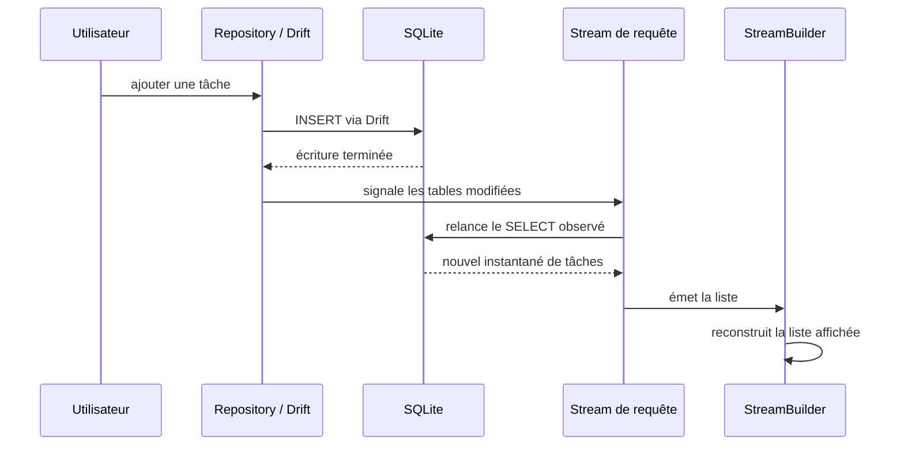

**Navigation :** [← Module 20](./20-migrations.md) · [Sommaire](../README.md) · [Module 22 →](./22-integration-gestion-etat.md)

# Module 21 — Les requêtes réactives avec Drift

## 1. Objectif pédagogique

Vous distinguerez une lecture ponctuelle `get()` d’une requête `watch()`, comprendrez les Streams Drift et suivrez le trajet complet d’une écriture jusqu’à la mise à jour de l’UI.

## 2. Le problème à résoudre

Un écran lit les tâches une fois au démarrage. Après que l’utilisateur en ajoute une, le résultat de ce premier `Future` ne change pas : l’écran doit-il relire à la main et appeler `setState` après chaque opération?

## 3. Explication du fonctionnement

`get()` exécute la requête une fois et renvoie un `Future`. `watch()` transforme la requête en Stream qui émet un résultat actuel à l’abonnement, puis de nouveaux résultats lorsque Drift estime qu’une table lue a été modifiée par une requête exécutée via Drift. Cette observation est implémentée comme un suivi des tables/écritures, pas comme un déclencheur universel fourni par SQLite.

`StreamBuilder` s’abonne au Stream, expose les états de connexion/chargement/données/erreur et reconstruit son sous-arbre quand une nouvelle liste arrive. L’écriture peut donc actualiser la liste sans appel manuel à `setState` pour rafraîchir celle-ci. `setState` reste utile pour un état d’interface différent, par exemple le filtre temporaire.

Le Stream doit avoir une identité stable, créée hors de `build` autant que possible; sinon chaque construction peut remplacer l’abonnement. Drift ne reçoit pas automatiquement les écritures réalisées depuis un autre client SQLite ou un outil externe. On peut signaler explicitement certaines mises à jour avec `notifyUpdates`, mais il faut bien connaître les tables/genres concernés.

## 4. Petit extrait de code

Requête dans une classe de base/repository Drift :

```dart
Stream<List<Task>> watchOpenTasks() => (select(tasks)
  ..where((t) => t.done.equals(false))).watch();
```

Consommation avec un Stream conservé par l’écran (créé hors de `build`) :

```dart
StreamBuilder<List<Task>>(
  stream: stableTasksStream,
  builder: (context, snapshot) => snapshot.hasData
      ? TaskListView(tasks: snapshot.data!)
      : const CircularProgressIndicator(),
)
```

## 5. Explication ligne par ligne

- `select(tasks)` construit un `SELECT` de tâches.
- `where` conserve les tâches ouvertes; `.watch()` retourne un `Stream<List<Task>>`, au lieu de l’exécuter une seule fois.
- `stableTasksStream` désigne ce Stream obtenu et conservé dans l’état/contrôleur, pas recréé à chaque appel de `build`.
- `StreamBuilder` s’y abonne. Tant qu’il n’a pas reçu de liste, l’exemple montre un indicateur; dès qu’il reçoit une liste, il passe celle-ci au widget de liste.
- Lors d’une erreur réelle, une UI complète devrait aussi traiter `snapshot.hasError`; ici l’extrait insiste sur le flux de succès initial.

## 6. Déroulement interne



## 7. Pourquoi cette approche ?

`watch` élimine la synchronisation manuelle entre lecture et écriture et convient à une liste qui doit rester actuelle. Il peut émettre plus souvent que strictement nécessaire; gardez les requêtes regardées raisonnables, filtrées et peu coûteuses. Pour une boîte de dialogue qui a besoin d’une seule lecture, `get` est généralement plus simple.

## 8. Erreur classique

**Erreur :** appeler `database.watchTasks()` à chaque `build`, ou attendre d’un Stream qu’il détecte les écritures externes arbitraires. **Correction :** conserver le Stream dans le cycle de vie approprié et comprendre que le suivi Drift observe principalement les modifications exécutées via Drift.

## 9. Questions de compréhension

1. Pourquoi une insertion via Drift provoque-t-elle une nouvelle émission alors qu’un `Future` déjà résolu ne change pas?
2. Pourquoi créer le Stream dans `build` peut-il réabonner inutilement l’écran?
3. Une modification faite par un client SQLite externe déclenche-t-elle automatiquement le suivi Drift?
4. Quelle partie se reconstruit lorsque `StreamBuilder` reçoit un instantané?

## 10. Petit exercice pratique

- **Objectif :** tracer l’actualisation réactive.
- **Situation de départ :** une liste ouverte est affichée avec `watch`; un bouton ajoute une tâche via Drift.
- **Résultat attendu :** nouvel instantané affiché sans appel `setState` dédié à la liste.
- **Consignes :** ordonnez INSERT, modification SQLite, notification de la requête observée, émission du Stream et reconstruction.
- **Critères de réussite :** vous mentionnez que le suivi est déclenché par une écriture Drift sur une table suivie.
- **Indice facultatif :** `watch` refait la lecture et émet un résultat, ce n’est pas une mutation de la liste Dart existante.

## 11. Résumé essentiel

- `get()` donne un résultat ponctuel; `watch()` donne un Stream actualisable.
- L’abonnement reçoit un instantané initial puis des résultats ultérieurs.
- Une écriture Drift pertinente déclenche la réexécution de requêtes suivies et l’UI peut se reconstruire via `StreamBuilder`.
- Le suivi est heuristique et ne voit pas automatiquement les écritures externes à Drift.

## 12. Lien avec le module suivant

Nous savons relier une requête observée à l’UI. Le dernier module d’intégration compare maintenant comment l’orchestrer avec différents gestionnaires d’état.
