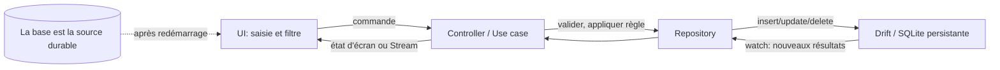

**Navigation :** [← Module 21](./21-requetes-reactives.md) · [Sommaire](../README.md) · [Module 23 →](./23-bonnes-pratiques.md)

# Module 22 — Intégrer Drift avec la gestion d’état Flutter

## 1. Objectif pédagogique

Vous saurez répartir l’ajout, l’affichage, la modification de statut et la suppression entre base durable, logique applicative et état temporaire, puis choisir un mode d’intégration adapté.

## 2. Le problème à résoudre

La liste de tâches doit rester disponible après fermeture, se mettre à jour dès l’écriture et pouvoir être filtrée. Si le contrôleur recopie la liste complète en mémoire et que Drift la stocke aussi, les deux sources peuvent diverger.

## 3. Explication du fonctionnement

La **base Drift** contient la source persistante : identifiant, titre, statut, dates et projet. L’**état d’interface** contient le filtre courant, le texte du formulaire, le menu ouvert et éventuellement l’état de chargement/erreur. La **logique métier** valide un titre, change un statut ou coordonne une suppression. Le **repository/DAO** effectue les requêtes Drift.

- Avec **setState**, utilisez-le pour un filtre local; consommez la liste Drift avec un StreamBuilder ou déclenchez une lecture ponctuelle appropriée.
- Avec **Provider + ChangeNotifier**, fournissez un repository/contrôleur dans la portée utile. Le notifier peut porter actions et état d’écran; si la liste arrive déjà par un Stream Drift, évitez d’en garder une copie mutable redondante.
- Avec **Riverpod**, un `StreamProvider` peut exposer `watchTasks`; un provider de commande/notifier peut appeler l’écriture. `ref.watch` relie la valeur à l’UI; `ref.read` convient généralement à l’action d’un bouton.
- Avec **BLoC/Cubit**, le contrôleur appelle le repository et expose des états (chargement, liste, échec); le flux Drift peut être écouté et reflété en nouvel état. Les événements BLoC ou méthodes Cubit sont le point d’entrée des commandes.

Repères de connexion UI → état/données (extraits schématiques, dépendants des packages choisis) :

| Approche | Lire/observer | Envoyer une action |
|---|---|---|
| `setState` + Drift | `StreamBuilder(stream: tasksStream)` | `repository.addTask(title)`; `setState` ne sert qu’au filtre local. |
| Provider + `ChangeNotifier` | `context.watch<TasksController>()` | `context.read<TasksController>().addTask(title)`; le contrôleur peut écouter le Stream du repository et notifier ses consommateurs. |
| Riverpod | `ref.watch(taskStreamProvider)` | `ref.read(taskActionsProvider).addTask(title)` |
| Cubit (`flutter_bloc`) | `BlocBuilder<TasksCubit, TasksState>` | `context.read<TasksCubit>().addTask(title)` |
| BLoC (`flutter_bloc`) | `BlocBuilder<TasksBloc, TasksState>` | `context.read<TasksBloc>().add(TaskCreated(title))` |

## 4. Petit extrait de code

Exemple conceptuel Riverpod (imports et providers de dépendances omis) :

```dart
final taskStreamProvider = StreamProvider<List<Task>>(
  (ref) => ref.watch(taskRepositoryProvider).watchTasks(),
);
final tasks = ref.watch(taskStreamProvider);
```

## 5. Explication ligne par ligne

- `taskStreamProvider` représente une dépendance asynchrone dont la source est le Stream Drift retourné par le repository.
- `ref.watch(taskRepositoryProvider)` établit une dépendance entre providers : si le repository fourni change, le provider de tâches se recalcule.
- `ref.watch(taskStreamProvider)` dans l’UI écoute son état et reconstruit le consommateur lors d’une émission, d’un chargement ou d’une erreur.
- La liste persistée n’est pas copiée dans une variable indépendante. Une commande `addTask` peut, elle, être déclenchée par `ref.read(commandProvider)` depuis le callback du bouton.

Dans le tableau, `context.watch` abonne le widget à la valeur exposée par Provider et le fait reconstruire; `context.read` obtient la dépendance pour appeler une action sans s’abonner à cet endroit. Le `ChangeNotifier` doit notifier après une vraie mutation de son état d’écran et se désabonner du Stream du repository dans son cycle de vie. `ref.watch` est l’écoute déclarative Riverpod; `ref.read` déclenche généralement une commande. `BlocBuilder` reconstruit à partir des états du Cubit/BLoC; un Cubit reçoit une méthode, un BLoC reçoit un événement. Dans tous les cas, le repository reste le point d’accès à Drift.

Le même partage conceptuel avec Provider se ferait en exposant le repository/notifier dans la branche nécessaire; un `ChangeNotifier` appelle une méthode de commande et notifie s’il change un état de présentation. En BLoC/Cubit, la commande devient un événement ou une méthode; le repository fournit le résultat/Stream. L’extrait montre le contrat, pas une app complète.

## 6. Déroulement interne



Pour « ajouter », le formulaire envoie un titre. Pour « afficher », la requête réactive fournit les lignes. Pour « modifier statut » ou « supprimer », la commande identifie une tâche et appelle Drift; la liste observée se met à jour. Au redémarrage, l’app se réabonne et lit les lignes existantes.

## 7. Pourquoi cette approche ?

Elle évite de confondre vérité durable et copie d’affichage. Le gestionnaire d’état apporte une orchestration adaptée à l’écran, tandis que Drift se charge de la persistance et des requêtes. Pour une page simple, `setState` + StreamBuilder suffit; un graphe partagé ou des transitions complexes justifient un système plus structuré.

## 8. Erreur classique

**Erreur :** réécrire la liste en mémoire après l’écriture tout en regardant Drift, ou appeler une requête à chaque `build`. Cela crée des mises à jour en double, des états dépassés et des flux redémarrés. **Correction :** choisir la base comme source durable, observer sa requête une fois et stocker séparément seulement l’état d’interface/métier qui n’est pas déjà dérivé.

## 9. Questions de compréhension

1. Le filtre d’écran doit-il être stocké dans SQLite si sa perte à la fermeture est acceptable?
2. Si Drift émet déjà la liste à jour, quel problème pose une copie mutable parallèle dans un notifier?
3. Quel rôle joue le `StreamProvider` par rapport au repository?
4. Quelle est la différence entre commande métier et donnée persistée?

## 10. Petit exercice pratique

- **Objectif :** dessiner l’architecture d’une page de tâches.
- **Situation de départ :** il faut ajouter, afficher, cocher et supprimer des tâches; les tâches survivent au redémarrage, le filtre peut être perdu.
- **Résultat attendu :** Drift pour les tâches, état d’écran pour le filtre, couche d’action/repository entre UI et base.
- **Consignes :** choisissez `setState`, Provider, Riverpod ou BLoC pour cette petite page et dessinez un flux de lecture et un flux d’écriture.
- **Critères de réussite :** toute solution est défendable si elle conserve les responsabilités distinctes et ne duplique pas la source des tâches.
- **Indice facultatif :** le choix le plus simple peut être suffisant tant que la portée reste locale.

## 11. Résumé essentiel

- SQLite/Drift conserve les tâches; l’interface conserve des états temporaires comme le filtre.
- Le repository/DAO sépare les requêtes; le gestionnaire orchestre et expose l’état à l’UI.
- Un Stream Drift peut fournir la liste; il est rarement utile d’en maintenir une seconde copie mutable.
- `setState`, Provider/ChangeNotifier, Riverpod et BLoC/Cubit orchestrent différemment, mais ne remplacent pas le stockage.

## 12. Lien avec le module suivant

Les mécanismes sont désormais réunis. Nous allons consolider les erreurs habituelles avant de vérifier le comportement avec des tests.
